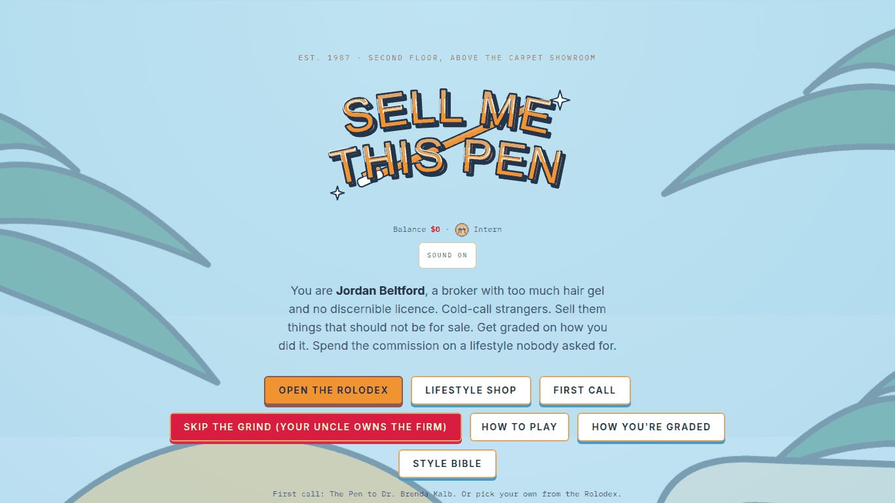
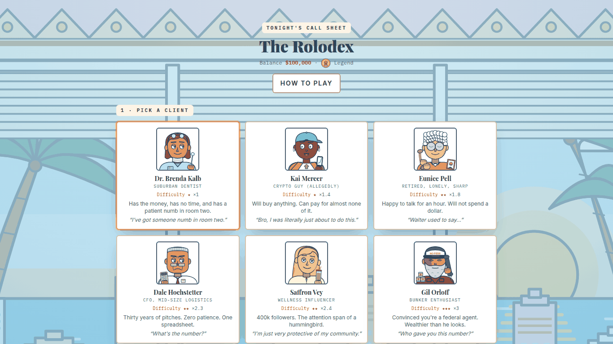
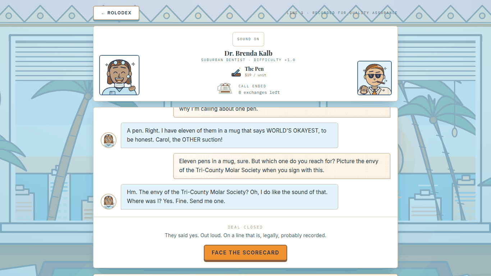
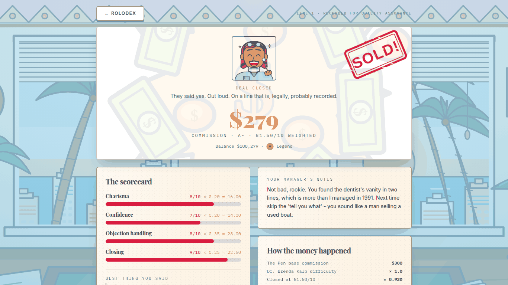

# Sell Me This Pen

A satirical cold-calling game: phone AI clients, sell them things that should not be for sale, get graded by an LLM judge, spend the commission on a tasteless lifestyle.

**Live: https://sellmethispen.vercel.app**. Try it: open it, hit "Skip the grind", call anyone.






## How it works

- **The client is an LLM in character.** Each persona has a prompt (voice, resistance, one weakness) and ends the call with a `[CLOSED]` or `[HANGUP]` token, which the server strips before the player sees it.
- **A second LLM judges the transcript** against a weighted rubric (charisma, confidence, objection handling, closing) with calibration examples, returning a strict JSON schema. A pure function turns the verdict into a commission.
- **Progression** lives in `localStorage` (Zustand persist, versioned migrations). Rank gates which clients and items appear.
- **Art** is hand-built SVG in a fixed palette. **Sound** is Web Audio SFX, no audio files.

## Stack

Next.js 16 (App Router), React 19, TypeScript, Tailwind 4, Zustand, Zod, Groq behind a server-side proxy (the key never reaches the browser), Vercel.

## Interesting problems

- **Judge 502s.** Groq's strict `json_schema` mode rejected over-long strings (`bestLine` past `maxLength`). Length bounds are now stripped from the schema sent to Groq, enforced server-side instead, with one bounded retry.
- **Payout exactly once.** The commission is banked from an event, guarded by refs against double clicks and React 19 dev double-effects, and deduplicated by a per-call UUID in the store.
- **Clients that never close.** Models would stall with "let me think about it" forever. Fixed with a hard prompt rule: a handled objection plus a concrete ask must end in a yes and `[CLOSED]`.

## Run locally

```bash
cd cold
npm install
cp .env.example .env.local   # add GROQ_API_KEY
npm run dev
npm test                     # node --test, no extra dependencies
```
